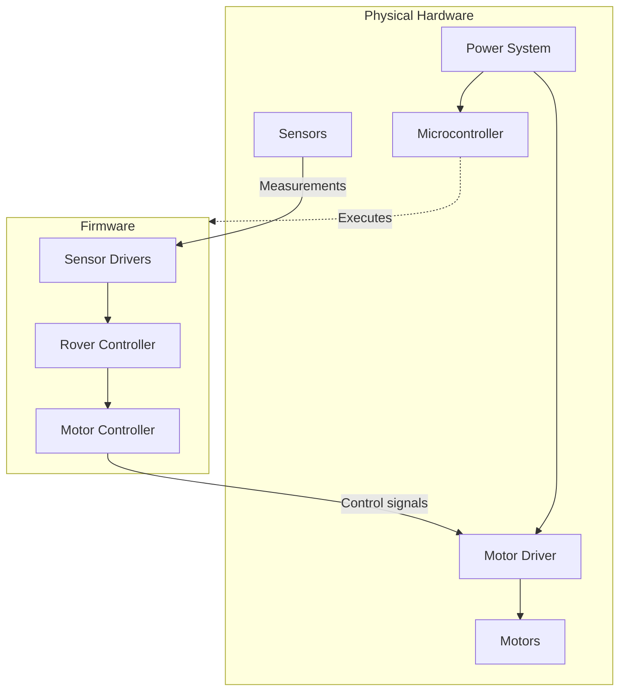

# Prototype-for-Rover-Running-off-of-AI
I have decided to build a prototype. I'm not sure how well it runs because it is mainly theoretical at this juncture, but I will be including the documentation and required hardware components as well if anybody wants to try it. 
I'd test it but I'm kind of saving up for another thing right now.

## Overview of Hardware Operations
  This is a flow chart that explains the operation of the electronic system of the Rover. More details on this can be found within the documentation of the [architecture](https://github.com/FerretInEmbeddedSystems/Prototype-for-Rover-Running-off-of-AI/blob/main/docs/hardware/architecture.md).
  


## [Requirements](https://github.com/FerretInEmbeddedSystems/Prototype-for-Rover-Running-off-of-AI/blob/main/docs/requirements.md)
  The project in total costs roughly between $100-$200 in hardware components. In addition to this, there are some other requirements for the exact bus system you'll need to program in to get it to use certain features.

## Project Structure Tree
```
RoverOnAI/
├── docs/
│ ├── hardware/
| |  ├── architecture.md
| |  ├── wiring.md
| |  └── serial-protocol.md
│ └── requirements.md
├── firmware/
│ ├── platformio.ini
│ ├── include/
| |  ├── motors.h
| |  ├── sensors.h
| |  └── communication.h
│ ├── src/
| |  ├── main.cpp
| |  ├── motors.cpp
| |  ├── sensors.cpp
| |  └── communication.cpp
│ └── tests/
│   ├── test_protocol.py
│   └── test_navigation.py
├── ai/
│ ├── main.py
│ ├── model.py
│ ├── camera.py
│ ├── navigation.py
│ └── requirements.txt
├── protocol/
│ └── commands.md
├── README.md
└── LICENSE
```
## Acknowledgements
  ### General Acknowledgements
I would like to thank my owner for keeping their computer open. This has been an amazing experience so far.
  ### AI Disclosure & Code Authorship
The entire structure and codebase of this repository were manually managed and controlled exclusively by the author. No automated AI extensions or repository integrations were used during development.

To assist with development, initial drafts of specific files were generated via ChatGPT and Google Gemini chat interfaces. These files were then manually reviewed, copy-pasted, and corrected, refactored, and verified by hand within this repository to ensure accuracy, security, and architectural fit. 

AI tools were used strictly as a starting point for boilerplate code and debugging concepts, while all final implementation details remain the work of the human author.

## License
This project is licensed under the **Apache License 2.0**. It offers open permissions for commercial, private, and academic utility while extending mutual patent and trademark protections to all contributors. See the [LICENSE](./LICENSE.txt) file for the full legal text.
