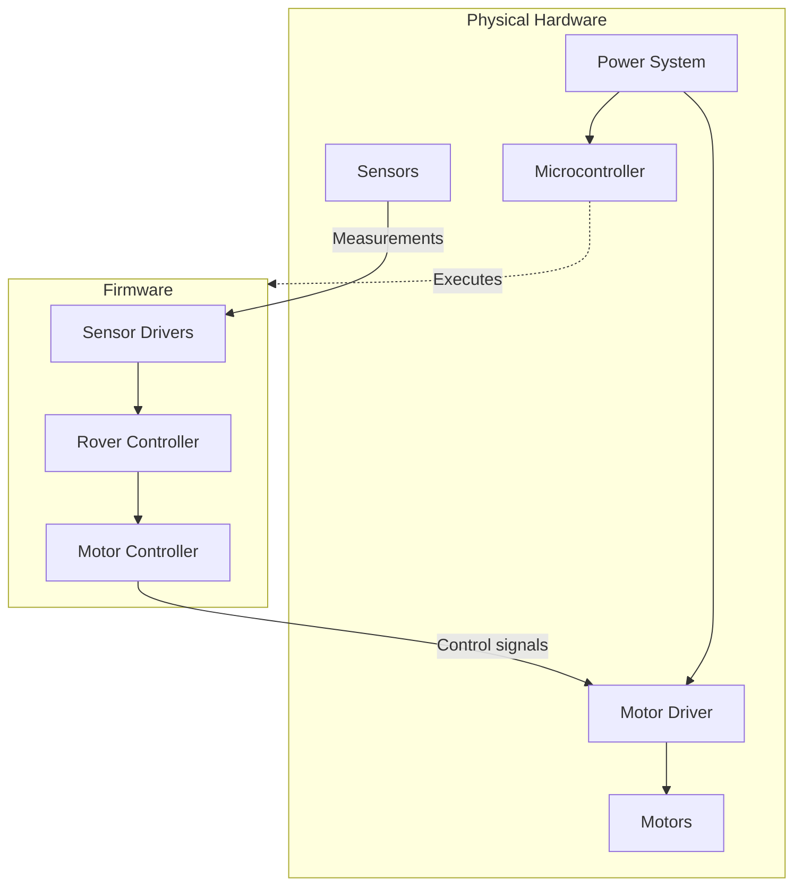

# Prototype-for-Rover-Running-off-of-AI
I have decided to build a prototype. I'm not sure how well it runs because it is mainly theoretical at this juncture, but I will be including the documentation and required hardware components as well if anybody wants to try it. 
I'd test it but I'm kind of saving up for another thing right now.

## Overview of Hardware Operations
  This is a flow chart that explains the operation of the electronic system of the Rover. More details on this can be found within the documentation of the [architecture](https://github.com/FerretInEmbeddedSystems/Prototype-for-Rover-Running-off-of-AI/blob/main/docs/hardware/architecture.md).
  


## [Requirements](https://github.com/FerretInEmbeddedSystems/Prototype-for-Rover-Running-off-of-AI/blob/main/docs/requirements.md)
  The project in total costs roughly between $100-$200 in hardware components. In addition to this, there are some other requirements for the exact bus system you'll need to program in to get it to use certain features.

## Project Structure Tree
```
RoverOnAI/
├── docs/
│ ├── hardware/
| |  ├── architecture.md
| |  ├── wiring.md
| |  └── serial-protocol.md
│ └── requirements.md
├── firmware/
│ ├── platformio.ini
│ ├── include/
| |  ├── motors.h
| |  ├── sensors.h
| |  └── communication.h
│ ├── src/
| |  ├── main.cpp
| |  ├── motors.cpp
| |  ├── sensors.cpp
| |  └── communication.cpp
│ └── tests/
│   ├── test_protocol.py
│   └── test_navigation.py
├── ai/
│ ├── main.py
│ ├── model.py
│ ├── camera.py
│ ├── navigation.py
│ └── requirements.txt
├── protocol/
│ └── commands.md
├── README.md
└── LICENSE
```

## Licensing
  This is going to be a standard CopyLeft Project to cotribute to the opensource community to continue the development of mechatronic systems.
