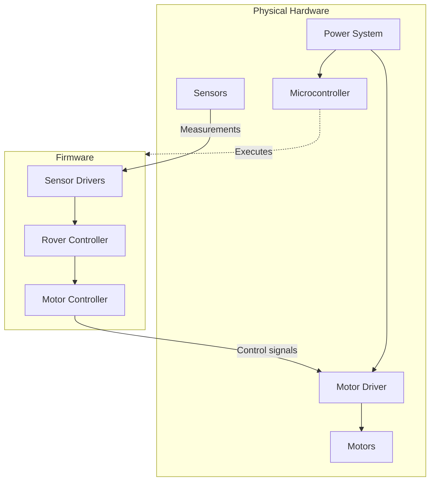
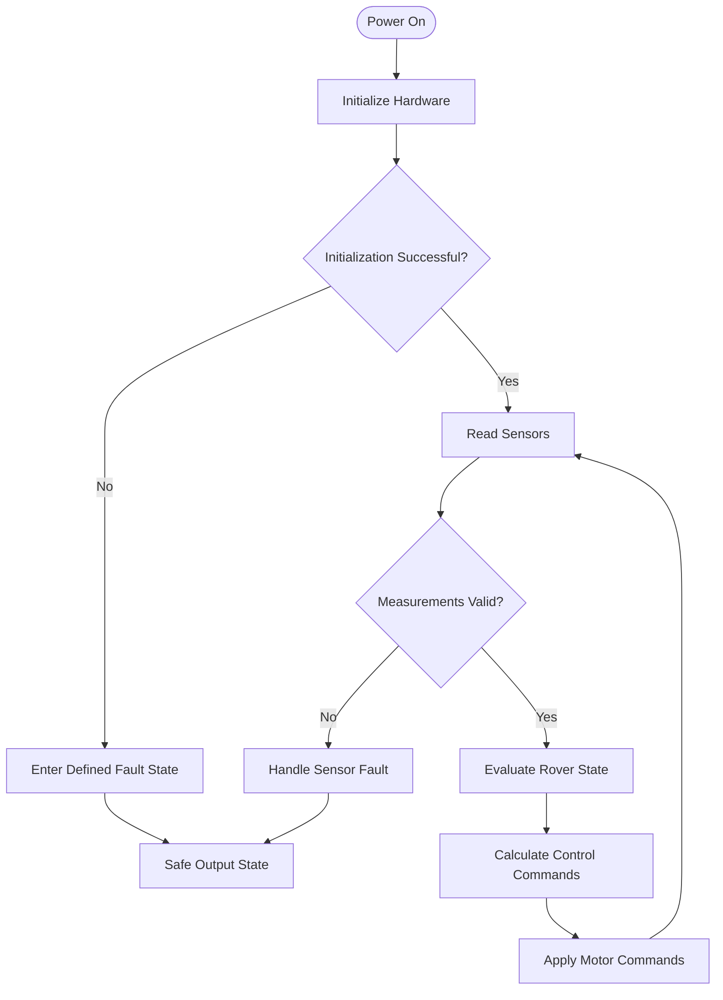

# System Architecture
  As you can see, it will really help to have an organized flow chart and diagram of how all the pieces will be getting put together for this project.
  Let's do that.

## Purpose and Scope
  This is obviously the subsystem that is the hardware that operates an AI driven rover prototype. It is composed of those subsystems.

## Hardware Architectural Diagram
  This is the Diagram of how all of the hardware, explained in the requirements, is all placed together.

### Hardware Execution Chart(Physical Components + Firmware Modules)

### Firmware Execution Chart(AKA Runtime Behavior/Code Execution Path)

## Component Responsibilities
  This feels rather redundant, but if you have a camera, then it's probably a camera.
  If you have a servo DC motor, then it's probably a motor that causes it to move around.
  If you have a companion computer, then it has to be the hardware running the AI system to drive the rover.
  If you have a microcontroller, then you probably have a control panel that holds the code to operate the other components in relation to one another.
  If you have a power system, then it probably powers the system.

  Pretty straight forward altogether and not too complicated to pick up, even on the initial lookover.

## Hardware Interfaces
GPIO, PWM, I²C, UART, SPI, power connections, and other interfaces actually used.

## Firmware Interface Boundary
  I am going to assume that everything talks to the microcontroller and we start from that jumping block into describing this part.

## Constraints and Safety
  Please do not download any unsafe files or buy parts from the dark web. Do not electrocute yourself, eat any part of the rover, create a sentient machine god, or somehow manage to tear off a limb with the very weak components. This is obviously an incredibly dangerous project and you should proceed with incredible caution.

## References
  This will likely be information found on their arduino, adafruit, sparkfun, or on some other website that has Pi tutorials.
